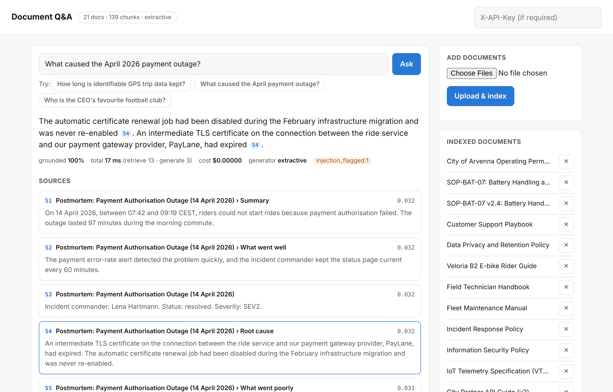

# RAG Document Q&A — GPT-based retrieval with a measurable evaluation layer

[](https://github.com/aymguemmaz-tech/rag-document-qa/actions/workflows/ci.yml)


A production-style retrieval-augmented generation (RAG) system that answers questions about your
documents **with citations**, refuses to answer when the documents do not contain the answer, and
comes with an **evaluation layer that measures every design choice** instead of judging answers by eye.



> **Work in progress** — the project is published in stages, each one tested in CI.

## Roadmap

- [x] **Core** — typed data model, deterministic tokenizer, sentence splitter and stemmer, configuration
- [x] **Ingestion** — Markdown, PDF, HTML and text loaders; four chunking strategies; OpenAI, WordLlama and hashing embedders with a SQLite cache
- [x] **Storage** — in-memory store and PostgreSQL/pgvector (HNSW) with Okapi BM25 computed in SQL
- [x] **Generation** — OpenAI-compatible LLM client, versioned prompts, `[S#]` citations, injection guard, grounding verifier, extractive baseline
- [x] **Retrieval** — hybrid search with Reciprocal Rank Fusion, four rerankers, multi-query and HyDE expansion
- [x] **Serving** — RAG pipeline, FastAPI service with streaming, web UI, `ragqa` CLI
- [x] **Evaluation** — 150-question gold set with evidence spans, metrics, bootstrap CIs, permutation tests
- [ ] **Ablations** — experiment grid, output variability study, report with charts, CI quality gate
- [ ] **Deployment** — Docker image, docker compose with pgvector, Makefile
- [ ] **Results** — reference evaluation run
- [ ] **Guide** — PDF walkthrough of the whole project

## Quickstart

```bash
git clone https://github.com/aymguemmaz-tech/rag-document-qa.git
cd rag-document-qa
python -m venv .venv && source .venv/bin/activate
pip install -e ".[dev]"
```

**Lite mode — no API key, no database** (WordLlama embeddings + extractive answers):

```bash
ragqa ingest data/corpus
ragqa ask "How long is identifiable GPS trip data kept?"
ragqa serve                       # web UI + API on http://127.0.0.1:8000 (docs at /docs)
```

**GPT mode** (OpenAI embeddings + `gpt-6-luna`; any OpenAI-compatible server works via `RAGQA_LLM_BASE_URL`):

```bash
export OPENAI_API_KEY=sk-...
ragqa ingest data/corpus --collection gpt      # a new collection: different embedder, different vectors
ragqa ask "What caused the April payment outage?" --collection gpt
```

## Evaluation

The sample corpus is a **fictional** company (Veloria Mobility, an e-scooter operator), so a model
cannot answer from memory: 150 questions with evidence spans measure grounding, not recall of the internet.

```bash
ragqa eval validate                                   # every evidence span exists verbatim in the corpus
```

## Development

```bash
pytest                            # add RAGQA_TEST_DATABASE_URL=postgresql://... for the pgvector tests
ruff check . && ruff format --check . && mypy
```

## Author

Aymen Charef Eddine Guemmaz — [LinkedIn](https://www.linkedin.com/in/aymen-charef-eddine-guemmaz-17a118329) ·
[GitHub](https://github.com/aymguemmaz-tech). Released under the [MIT License](LICENSE).
