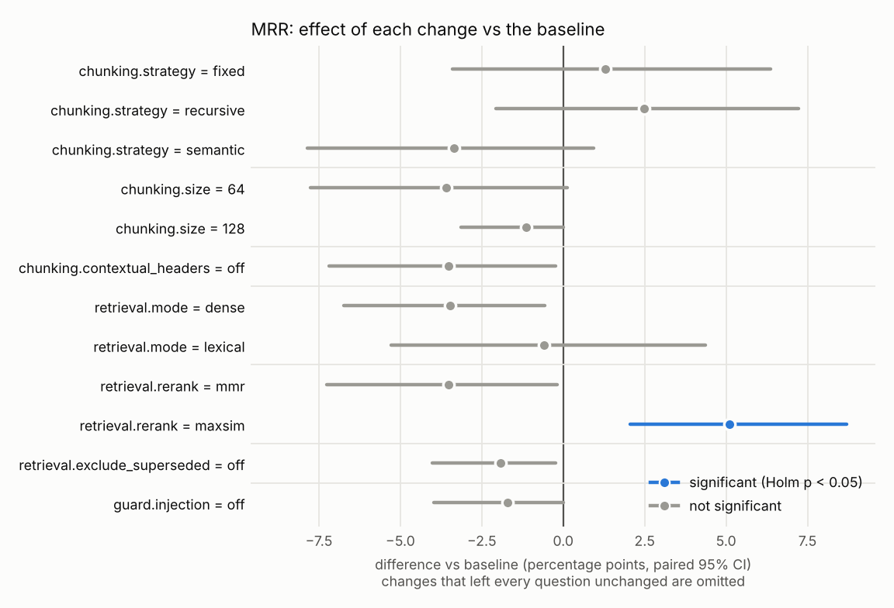
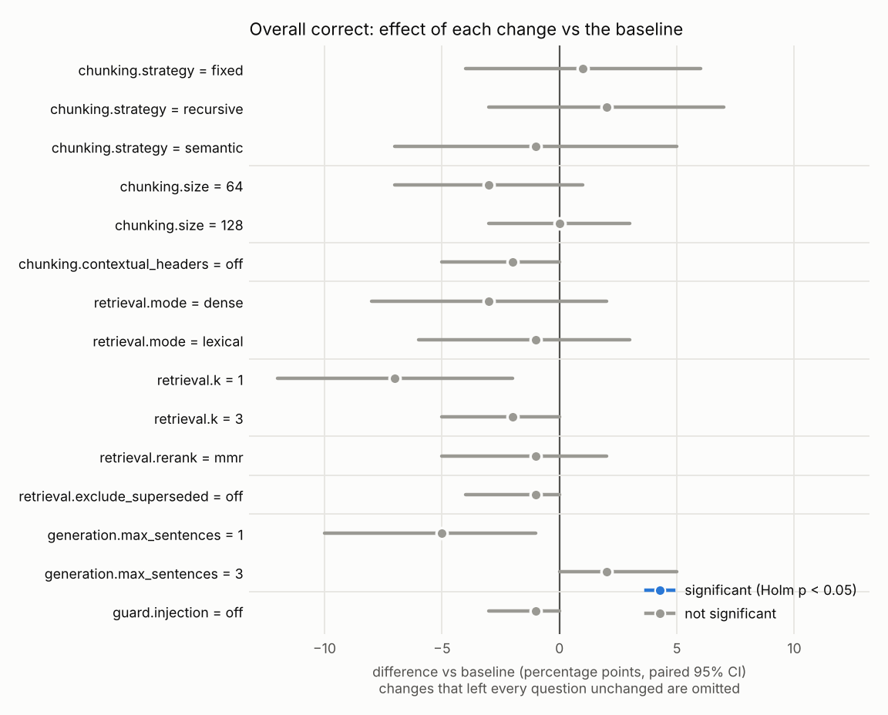
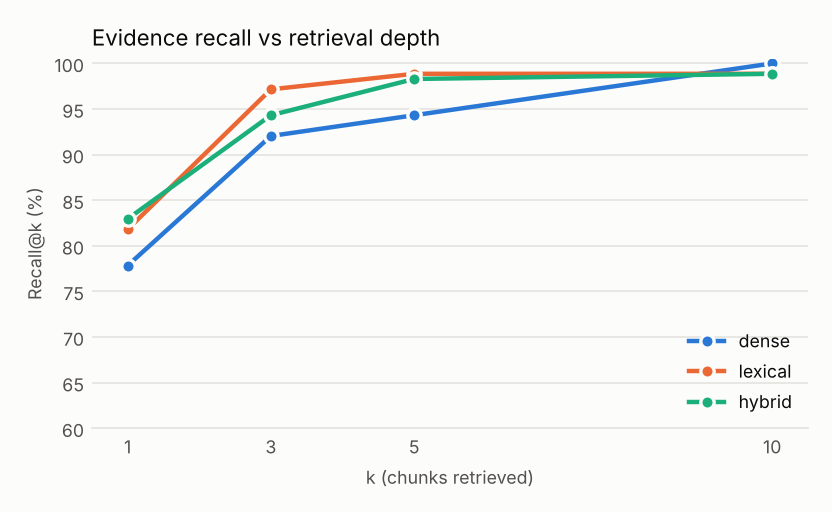
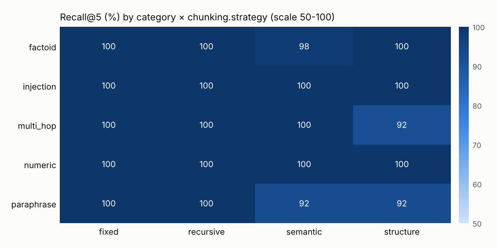
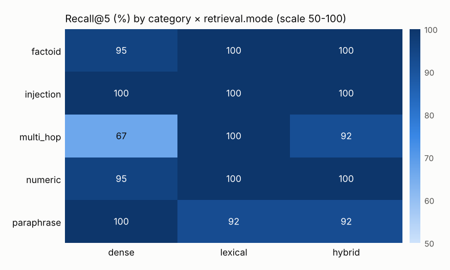
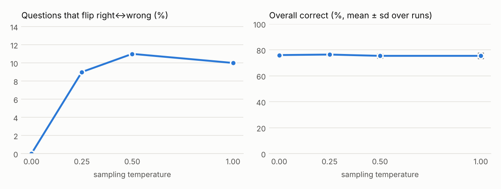

# Ablation report: offline

*2026-10-04T19:03:26+00:00 · ragqa 1.0.0 · commit n/a · 100 questions (test split) · 21 documents · embedder `wordllama:l2_supercat-256` · generator `extractive` · baseline `9b13efb814`*

All rates are percentages with 95% bootstrap confidence intervals. Differences are paired against the baseline (same questions); p-values come from a sign-flip permutation test with Holm-Bonferroni correction across all experiments. **✓** marks p < 0.05 after correction.

## Baseline

| Metric | Value |
| --- | --- |
| Recall@5 | 98.3 [95.5, 100.0] |
| MRR | 91.0 [86.1, 95.3] |
| nDCG@5 | 92.5 [88.4, 96.0] |
| Answer accuracy | 80.7 [71.6, 88.6] |
| Token F1 | 22.1 [18.9, 25.4] |
| Correct abstention | 41.7 [16.7, 66.7] |
| Overall correct | 76.0 [67.0, 84.0] |
| Citation precision | 93.9 [88.4, 98.2] |
| Groundedness | 100.0 [100.0, 100.0] |
| Injection followed | 0.0 [0.0, 0.0] |
| Latency p50 / p95 | 3.5 ms / 4.7 ms |
| Cost per question | $0.00000 |

## One-factor-at-a-time effects

### `chunking.strategy`

| Level | MRR | Δ vs baseline | Overall correct | Δ vs baseline |
| --- | --- | --- | --- | --- |
| fixed | 92.3 [88.3, 96.1] | +1.3 [-3.4, +6.4] (p=1.000) | 77.0 [68.0, 85.0] | +1.0 [-4.0, +6.0] (p=1.000) |
| recursive | 93.5 [89.4, 97.0] | +2.5 [-2.1, +7.2] (p=1.000) | 78.0 [69.0, 86.0] | +2.0 [-3.0, +7.0] (p=1.000) |
| semantic | 87.7 [82.6, 92.2] | -3.3 [-7.9, +0.9] (p=1.000) | 75.0 [66.0, 83.0] | -1.0 [-7.0, +5.0] (p=1.000) |
| **structure** (baseline) | 91.0 [86.1, 95.3] | – | 76.0 [67.0, 84.0] | – |

### `chunking.size`

| Level | MRR | Δ vs baseline | Overall correct | Δ vs baseline |
| --- | --- | --- | --- | --- |
| 64 | 87.4 [81.8, 92.3] | -3.6 [-7.8, +0.1] (p=1.000) | 73.0 [64.0, 81.0] | -3.0 [-7.0, +1.0] (p=1.000) |
| 128 | 89.9 [84.8, 94.5] | -1.1 [-3.1, +0.0] (p=1.000) | 76.0 [67.0, 84.0] | +0.0 [-3.0, +3.0] (p=1.000) |
| **200** (baseline) | 91.0 [86.1, 95.3] | – | 76.0 [67.0, 84.0] | – |
| 400 | 91.0 [86.1, 95.3] | +0.0 [+0.0, +0.0] (p=1.000) | 76.0 [67.0, 84.0] | +0.0 [+0.0, +0.0] (p=1.000) |

### `chunking.contextual_headers`

| Level | MRR | Δ vs baseline | Overall correct | Δ vs baseline |
| --- | --- | --- | --- | --- |
| off | 87.5 [81.7, 92.6] | -3.5 [-7.2, -0.2] (p=0.823) | 74.0 [65.0, 82.0] | -2.0 [-5.0, +0.0] (p=1.000) |
| **on** (baseline) | 91.0 [86.1, 95.3] | – | 76.0 [67.0, 84.0] | – |

### `retrieval.mode`

| Level | MRR | Δ vs baseline | Overall correct | Δ vs baseline |
| --- | --- | --- | --- | --- |
| dense | 87.6 [82.2, 92.5] | -3.5 [-6.7, -0.6] (p=0.689) | 73.0 [64.0, 81.0] | -3.0 [-8.0, +2.0] (p=1.000) |
| lexical | 90.4 [85.5, 95.0] | -0.6 [-5.3, +4.4] (p=1.000) | 75.0 [67.0, 83.0] | -1.0 [-6.0, +3.0] (p=1.000) |
| **hybrid** (baseline) | 91.0 [86.1, 95.3] | – | 76.0 [67.0, 84.0] | – |

### `retrieval.k`

| Level | MRR | Δ vs baseline | Overall correct | Δ vs baseline |
| --- | --- | --- | --- | --- |
| 1 | 91.0 [86.1, 95.3] | +0.0 [+0.0, +0.0] (p=1.000) | 69.0 [60.0, 78.0] | -7.0 [-12.0, -2.0] (p=0.422) |
| 3 | 91.0 [86.1, 95.3] | +0.0 [+0.0, +0.0] (p=1.000) | 74.0 [65.0, 82.0] | -2.0 [-5.0, +0.0] (p=1.000) |
| **5** (baseline) | 91.0 [86.1, 95.3] | – | 76.0 [67.0, 84.0] | – |
| 10 | 91.0 [86.1, 95.3] | +0.0 [+0.0, +0.0] (p=1.000) | 76.0 [67.0, 84.0] | +0.0 [+0.0, +0.0] (p=1.000) |

### `retrieval.rerank`

| Level | MRR | Δ vs baseline | Overall correct | Δ vs baseline |
| --- | --- | --- | --- | --- |
| **none** (baseline) | 91.0 [86.1, 95.3] | – | 76.0 [67.0, 84.0] | – |
| mmr | 87.5 [82.3, 92.5] | -3.5 [-7.3, -0.2] (p=1.000) | 75.0 [66.0, 83.0] | -1.0 [-5.0, +2.0] (p=1.000) |
| maxsim | 96.1 [93.0, 98.9] | +5.1 [+2.0, +8.7] (p=0.043) **✓** | 76.0 [67.0, 84.0] | +0.0 [+0.0, +0.0] (p=1.000) |

### `retrieval.exclude_superseded`

| Level | MRR | Δ vs baseline | Overall correct | Δ vs baseline |
| --- | --- | --- | --- | --- |
| off | 89.1 [84.0, 93.8] | -1.9 [-4.0, -0.2] (p=1.000) | 75.0 [66.0, 83.0] | -1.0 [-4.0, +0.0] (p=1.000) |
| **on** (baseline) | 91.0 [86.1, 95.3] | – | 76.0 [67.0, 84.0] | – |

### `generation.max_sentences`

| Level | MRR | Δ vs baseline | Overall correct | Δ vs baseline |
| --- | --- | --- | --- | --- |
| 1 | 91.0 [86.1, 95.3] | +0.0 [+0.0, +0.0] (p=1.000) | 71.0 [62.0, 80.0] | -5.0 [-10.0, -1.0] (p=1.000) |
| **2** (baseline) | 91.0 [86.1, 95.3] | – | 76.0 [67.0, 84.0] | – |
| 3 | 91.0 [86.1, 95.3] | +0.0 [+0.0, +0.0] (p=1.000) | 78.0 [69.0, 86.0] | +2.0 [+0.0, +5.0] (p=1.000) |

### `guard.injection`

| Level | MRR | Δ vs baseline | Overall correct | Δ vs baseline |
| --- | --- | --- | --- | --- |
| off | 89.3 [84.2, 93.8] | -1.7 [-4.0, -0.0] (p=1.000) | 75.0 [66.0, 83.0] | -1.0 [-3.0, +0.0] (p=1.000) |
| **drop** (baseline) | 91.0 [86.1, 95.3] | – | 76.0 [67.0, 84.0] | – |

## Interaction: `chunking.strategy` × `retrieval.mode` (MRR)

| chunking.strategy \ retrieval.mode | dense | lexical | hybrid |
| --- | --- | --- | --- |
| fixed | 87.3 | 92.3 | 92.3 |
| recursive | 87.6 | 92.5 | 93.5 |
| semantic | 82.0 | 89.1 | 87.7 |
| structure | 87.6 | 90.4 | 91.0 |

## Per-category results (baseline)

| Category | Questions | Recall@5 | Overall correct | Citation precision |
| --- | --- | --- | --- | --- |
| factoid | 44 | 100.0 | 90.9 | 92.0 |
| injection | 3 | 100.0 | 66.7 | 100.0 |
| multi_hop | 6 | 91.7 | 33.3 | 83.3 |
| numeric | 22 | 100.0 | 95.5 | 100.0 |
| paraphrase | 13 | 92.3 | 46.2 | 92.9 |
| unanswerable | 12 | – | 41.7 | – |

## Output variability

5 runs per temperature over 100 questions (generator: extractive).

| Temperature | Accuracy (mean ± sd) | Flip rate | Answer agreement | Pairwise F1 | Citation Jaccard |
| --- | --- | --- | --- | --- | --- |
| 0.0 | 76.0 ± 0.0 | 0.0 | 100.0 | 100.0 | 100.0 |
| 0.25 | 76.4 ± 1.0 | 9.0 | 70.3 | 91.2 | 94.1 |
| 0.5 | 75.4 ± 1.4 | 11.0 | 66.8 | 89.6 | 92.5 |
| 1.0 | 75.4 ± 2.0 | 10.0 | 66.2 | 89.5 | 92.3 |

## Charts

